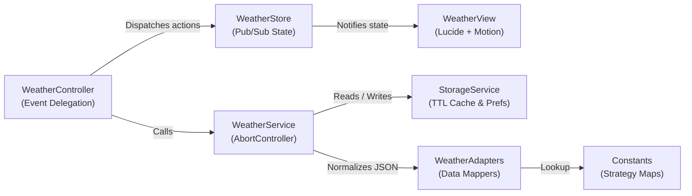

# Atmosphere — Modern Meteorological Dashboard

A modern, responsive meteorological dashboard built with **HTML5**, **CSS3 Design Tokens**, **Vanilla JavaScript (ES6+)**, **Lucide Vector Icons**, and **Motion Animations**. Powered by the **OpenWeatherMap API** and engineered with Clean Architecture & System Design patterns.

**Live Demo:** [weather-app-zeta-two-36.vercel.app](https://weather-app-zeta-two-36.vercel.app)

---

## ✨ Key Features

- **Real-Time Meteorological Telemetry** — Displays current temperature, high/low range, local city time, feels-like temperature, humidity, wind speed, atmospheric pressure, visibility, and sunrise/sunset cycle.
- **24-Hour Timeline & 5-Day Forecast** — Interactive 3-hour interval timeline with precipitation probability (`POP%`) and a 5-day forecast featuring proportional min/max temperature range bars.
- **Dynamic Weather Atmosphere** — Automatically adapts ambient background gradients and glassmorphic accents (`sunny`, `cloudy`, `rainy`, `stormy`, `snowy`, `misty`) to match live weather conditions.
- **Lucide Vector Icons & Motion Animations** — Crisp SVG iconography with semantic color tones and hardware-accelerated staggered entrance transitions.
- **Smart Caching & Race-Condition Protection** — Built-in 10-minute LocalStorage TTL cache (`Cache-Aside` pattern) with live/cached status indicator and `AbortController` request cancellation.
- **Geolocation & Recent Cities Bar** — One-click GPS location detection and persistent quick-access chips for recently searched cities.
- **Unit & Theme Persistence** — Instant `°C` / `°F` conversion (`km/h` ↔ `mph`) and Dark / Light theme toggle saved in `localStorage`.

---

## 🏗️ Architecture & Design Patterns

The application is structured into **7 decoupled layers**:



| Layer | File | Pattern Used | Responsibility |
| :--- | :--- | :--- | :--- |
| **1. Config** | `js/config/constants.js` | **Strategy Map** | Centralizes API config, `UI_ICONS`, and `WEATHER_CONDITION_MAP` lookup tables. |
| **2. Adapters** | `js/utils/weatherAdapters.js` | **Adapter / Mapper** | Pure functions transforming raw OpenWeatherMap responses into normalized UI models. |
| **3. Storage** | `js/services/storageService.js` | **Repository & Cache-Aside** | Manages user preferences (`theme`, `unit`, `recentCities`) and 10-min TTL weather cache. |
| **4. Network** | `js/services/weatherService.js` | **Service + AbortController** | Fetches current & forecast endpoints concurrently and cancels stale in-flight requests. |
| **5. State** | `js/store/weatherStore.js` | **Observer (Pub/Sub)** | Single source of truth notifying subscribed views on state transitions. |
| **6. View & Motion** | `js/ui/weatherView.js`<br>`js/ui/motionAnimator.js` | **Reactive View & Facade** | Renders DOM state, refreshes Lucide SVG icons, and triggers Motion animations. |
| **7. Controller** | `js/main.js` | **MVC / Flux Controller** | Binds UI events, delegates recent city clicks, and orchestrates initial load. |

---

## 📂 Project Structure

```text
weather-app/
├── assets/
│   └── images/                  # Weather condition & UI fallback assets
├── css/
│   └── style.css                # Design tokens, glassmorphic Bento grid & responsive rules
├── js/
│   ├── config/
│   │   └── constants.js         # API settings, Lucide icon map & condition strategy map
│   ├── services/
│   │   ├── storageService.js    # LocalStorage preferences & TTL cache service
│   │   └── weatherService.js    # OpenWeatherMap API client with AbortController
│   ├── store/
│   │   └── weatherStore.js      # Reactive Pub/Sub state container
│   ├── ui/
│   │   ├── motionAnimator.js    # Motion v11 animation facade
│   │   └── weatherView.js       # Reactive DOM renderer & Lucide icon manager
│   ├── utils/
│   │   └── weatherAdapters.js   # Pure formatting & API data adapter functions
│   └── main.js                  # Application controller & bootstrapper
├── index.html                   # Semantic Bento dashboard markup
├── package.json                 # Local development server scripts
└── README.md                    # Project documentation
```

---

## 🚀 Getting Started

### 1. Clone the repository
```bash
git clone https://github.com/karmabarca17/weather-app.git
cd weather-app
```

### 2. Configure your OpenWeatherMap API Key
Get a free API key at [openweathermap.org/api](https://openweathermap.org/api) and set `API_CONFIG.KEY` in `js/config/constants.js` (and `js/main.js`):
```javascript
export const API_CONFIG = {
    KEY: "YOUR_API_KEY",
    BASE_URL: "https://api.openweathermap.org/data/2.5",
    DEFAULT_CITY: "Tunis",
    CACHE_TTL_MS: 10 * 60 * 1000,
    MAX_RECENT_CITIES: 5,
};
```

### 3. Run the application
- **Option A — Local HTTP Server (Recommended):**
  ```bash
  npm start
  ```
- **Option B — VS Code Live Server:** Right-click `index.html` and select **Open with Live Server**.
- **Option C — Direct Browser Open:** Open `index.html` directly in any modern browser.

---

## 🛠️ Tech Stack

- **Markup & Styling:** Semantic HTML5, CSS3 Custom Properties (Design Tokens), CSS Grid (Bento Layout), Glassmorphism (`backdrop-filter`)
- **Scripting:** Vanilla JavaScript (ES2022+), Fetch API, `AbortController`, Geolocation API, `localStorage`
- **Icons & Motion:** [Lucide Icons](https://lucide.dev/) & [Motion](https://motion.dev/)
- **Weather Data:** [OpenWeatherMap Current & 5-Day Forecast API](https://openweathermap.org/api)

---

## 📄 License

Distributed under the **MIT License**.